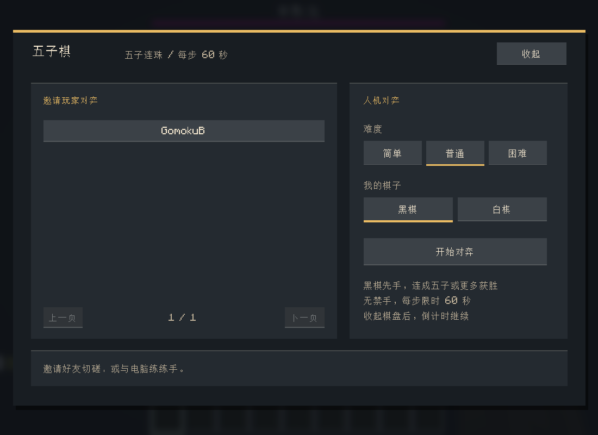
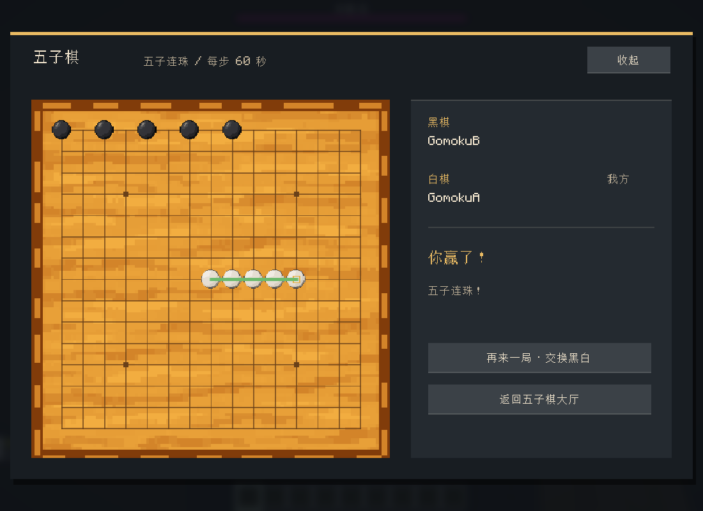

# 五子棋位图来源

2026-11-09 使用内置 imagegen 生成像素风原图，再经本机 ComfyUI PerfectPixel 清理，最后接入原生 GUI。没有用代码绘制或普通缩图替代 PerfectPixel。

## 原图提示词

棋盘：top-down square honey-colored wooden Gomoku board, pixel-art game UI texture, thin carved wooden frame, calm flat center with subtle wood grain, no grid, no stones, no text, no symbols, logical 128-pixel style, about 12 colors, hard pixel clusters, no smooth illustration or perspective.

棋子：transparent background, 2:1 horizontal pixel-art sprite atlas; one black and one ivory-white round Gomoku stone, centered at 25% and 75% of the canvas, equal size, logical 32-pixel sprites, stepped pixel highlights, crisp outlines, no text, no cast shadow outside each stone, no extra objects.

以上为生成意图记录；原图分别保留为 `board-original.png`、`stones-original.png`。

## PerfectPixel 与运行素材

- `board-workflow.json`：PerfectPixel Majority Cluster、OpenCV 后端、export scale 1；识别 94×94 网格，然后 nearest-exact 规范到 128×128 并量化为 16 色。
- `stones-workflow.json`：同样经 PerfectPixel；识别 59×31 网格，规范到 64×32 并量化为 12 色。原始 alpha 单独按最近邻缩放、0.5 阈值二值化，再合回 RGBA，保留透明底。
- `*-grid.png` 保存识别后的网格；`*-submission.json` 与 `*-history.json` 保存成功执行记录。
- 最终运行素材为 `assets/goosetools/textures/gui/gomoku/board.png` 与 `stones.png`。棋盘格线、最后一手标记及获胜连线由 GUI 绘制，不属于生成位图。
- 原生双客户端回归截图位于本地 `build/gomoku-regression/`，包含 GUI 缩放 1／2／3、棋局、获胜连线和菜单入口。

